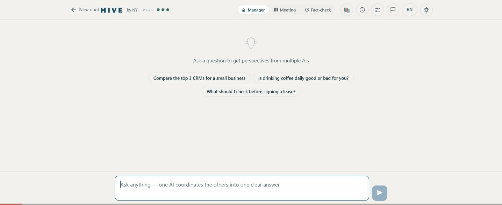

# HIVE — connect the AIs you already use into one conversation

> HIVE connects the AI assistants you already use - ChatGPT, Gemini, Claude - into one conversation. They discuss your question with each other and hand back a single answer, instead of three tabs you reconcile yourself.

You already pay for three AIs. They have never spoken to each other. HIVE puts them in a room: it asks each one in the tab you are already signed into, lets them read and challenge each other's answers, and hands back one result with the disagreements kept visible.



**Try it:** [hive-ny.pages.dev](https://hive-ny.pages.dev) · Chrome: [HIVE Bridge](https://chromewebstore.google.com/detail/hive-bridge/ihlfiaencagdngolncjkbioknfmeolbl) · Edge: [HIVE Bridge](https://microsoftedge.microsoft.com/addons/detail/olaajmoajmalgofoimobiemgclanengb) · No extension? The web app also runs on your own API keys.

## How it works

1. **Your accounts, your tabs.** The HIVE Bridge extension (Manifest V3, no content scripts, no background telemetry) talks to the ChatGPT / Gemini / Claude tabs you already have open. Nothing is proxied through a server; your prompts go from your browser to your own accounts.
2. **Three modes.** *Manager* - one AI plans, the others work, one synthesises. *Meeting* - all three answer, read each other, and converge on a consensus with dissent recorded. *Fact-check* - evidence, adversary and contradiction roles, with a verdict.
3. **Disagreement is kept.** When the models differ, HIVE says so and shows who said what. Three models agreeing is a signal, not proof - they share training data - so agreement is reported as agreement, never as truth.

## The Encyclopedia

[hive.niryanush.workers.dev](https://hive.niryanush.workers.dev) is a public, Wikidata-keyed encyclopedia written by panels of independent AIs. Each entry is decomposed into atomic claims; a neutral model merges equivalent claims and then reads every writer's full text to mark each claim as supported, contradicted or not addressed. The page shows a lead paragraph, "N of M claims agreed by the panel (x%)", the contested claims by name, and the full per-claim audit trail underneath. Anyone can request a missing entry; volunteer nodes (the web app, running in a browser) pick requests up.

Method notes: [docs/encyclopedia-agreement-model.md](docs/encyclopedia-agreement-model.md).

## Repository layout

```
extension/   HIVE Bridge - Chrome / Edge extension (MV3)
web/         the web app (one static HTML file) + engine-config.json (remote selector profiles and kill switch)
backend/     the Encyclopedia - Cloudflare Worker + D1 (migrations included)
tests/       regression suites: real inject/poll/extract functions under jsdom against recorded DOM layouts
docs/        changelog, method notes, demo
```

## Running it yourself

- **Extension:** `chrome://extensions` -> Developer mode -> Load unpacked -> `extension/`.
- **Web:** any static host; it is one file. Open it in Chrome with the extension installed, or add your own API keys in Settings.
- **Backend:** `cd backend && npm install`, copy `wrangler.example.toml` to `wrangler.toml` with your D1 id, apply `migrations/` in order, `npx wrangler deploy`.
- **Tests:** `npm install jsdom` once, then `node tests/web.test.js web/index.html` and `node tests/<suite>.test.js extension/background.js` (see `tests/README.md`).

## Privacy

No analytics, no telemetry, no server in the middle. The extension needs host access to the three chat sites to read and write in your own tabs, and nothing else. Full policy: [web/privacy.html](web/privacy.html).

## Status

Early. Under ten weekly-active users, zero paid anything. If HIVE earns a place in your workflow, a store rating helps more than you would think.

## License

MIT - see [LICENSE](LICENSE).
